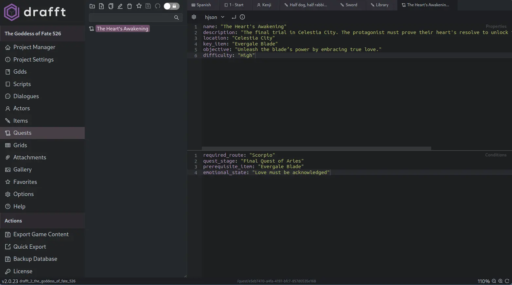

# Quests

Use Quest documents in Drafft to define in-game objectives, side missions, or main storyline beats.

Each Quest doc uses a **dual-pane editor**:

- **Properties**: Define quest metadata, narrative role, rewards, difficulty, etc.
- **Conditions**: Define the game state required to mark the quest as _completed_ (e.g., inventory contains item, dialogue flag is set, boss defeated).

Drafft supports flexible formats: **JSON**, **HJSON**, **TOML**, **YAML**, or plain **text**. Both panes are validated and exported as standard JSON under the hood.



---

## Example

```yaml title="Properties (yaml)"
title: "The Forest Trial"
reward: "Health Potion"
difficulty: "Easy"
optional: false
```

```yaml title="Conditions (yaml)"
defeatedBoss": true,
hasItems:
  - Health Potion
  - Magic Potion
```

## Script Addressability (`_sid`)

Add `_sid` to the Properties pane to reference the quest from scripts:

```yaml title="Properties (yaml)"
_sid: questA
title: "The Forest Trial"
reward: "Health Potion"
```

```uaf
${q.questA.title}
@if q.questA.status == "complete"
```

`@set q.questA.status = "complete"` creates a runtime override for simulation and scenarios; it does not modify the Quest document. Conditions are validated and exported but are not exposed at the `q` root.

A quest without `_sid` still opens, saves, and exports, but is not addressable from scripts. `content.json` stores the canonical Properties payload and `content.conditionsJson` stores the canonical Conditions payload.

See [Drafft Output Schema](/docs/reference/exporting/exporting_schema#quests-collection) for the JSON export schema.
